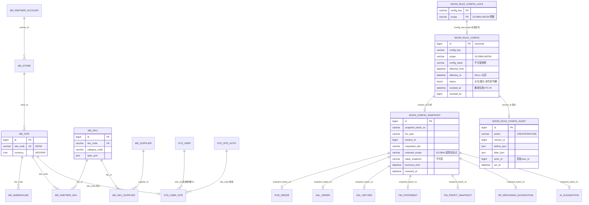
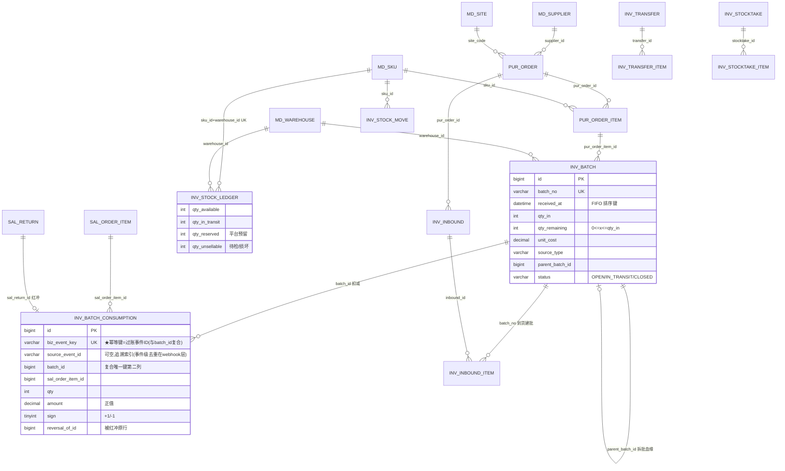
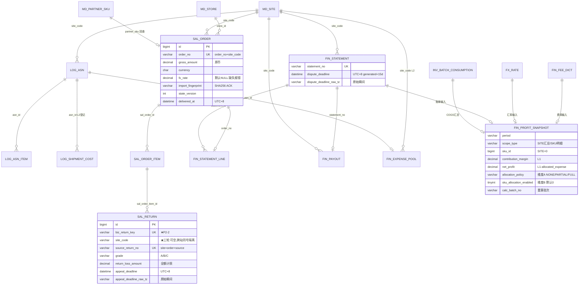
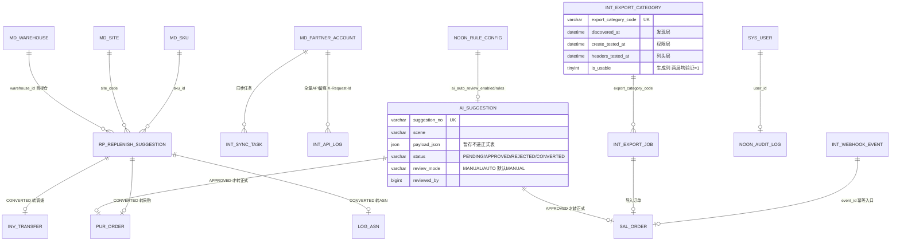

# Noon ERP 数据库 ER 图 v0.5

对应 DDL：`docs/noon-erp-schema-v0.5.sql`（72 表 + 5 视图在若依共存库中的实测值；本文件只画 Noon 业务域 52 张表，若依框架表另列）。
日期：2026-11-18（UTC+8）　执行者：WorkBuddy　状态：与 v0.5 SQL 逐表核对一致。

## 阅读约定

- **物理外键**：业务表一律逻辑关联（DDL 无 `FOREIGN KEY`）；图中连线表示 `子.字段 → 父.主键` 的逻辑引用，便于单体模块拆分与批量导入。唯一带物理外键的是若依侧 `sys_user_site → sys_user`（由 `yx-erp/sql/noon_wp1_site_auth.sql` 管理，不在本 DDL 重复定义）。
- **基数**：`||--o{` = 一对多；`}|--|{` = 多对多（经中间表）；`o|` = 零或一。
- **时区**：所有业务时刻 `DATETIME(3)` = UTC+8；带 `_raw_text/_raw_tz` 的字段保留平台原始截止瞬间，仅展示层换算。
- **★** 标记为核心/对接阻塞表。

## 1. 主数据 · 权限 · 参数（A 组）

**参数契约要点**（与框架侧 `EffectiveConfigResolver`/`VersionedConfigReader`/`ConfigIntervalPolicy` 一致）：
- 有效区间半开 `[effective_from, effective_to)`，`effective_to=NULL` 为无穷；`end = min(effective_to, revoked_at)`。
- 撤销：`业务时刻 < revoked_at` 旧版本可用，`= revoked_at` 起排除；历史解析**不得**用当前 `status` 或 `revoked_at IS NULL` 无条件过滤。
- 站点优先：同 key 下 `scope=真实站点` 命中优先于 `GLOBAL`；同 scope 多于一个有效版本 → 失败关闭。
- 写入：按 `(config_key, scope)` 先锁 `noon_rule_config_lock` 行，当前读候选 → 查重叠 → 追加新版本 → 写审计，同一事务；首行竞争需隔离 MySQL 并发测试（待定）。
- 重算：只读 `noon_config_snapshot.value_snapshot + version_id`，不查当前配置，仍 `requireSite(requested_site)`。

## 2. 采购 · FIFO 库存（B 组）

**守恒/幂等要点**：
- 部分到货只建已到货数量批次；未收部分挂采购行 `qty_ordered - qty_received`，不建在途批。
- 在途子批 `status=IN_TRANSIT` 且 `qty_remaining=0`，FIFO 只对已到货 `OPEN` 批扣减，避免双计。
- 退货先红冲原 `SALE` 消耗（`sign=-1, reversal_of_id`），再按 A/B/C 分级；赔偿只在 `COMPENSATION` 计一次。
- `uk_consume_biz_event(biz_event_key, batch_id)`：幂等键绑定**每次实际过账事件**（非订单行/原消耗 ID）。同一事件跨批次多条、同事件重传同批次被拦、不同部分妥投/退货事件（不同 key）可再次消费同批次——三条同时成立。事件 ID 来源优先平台履约号，缺失时应用按确定规则生成，无法识别进 NEEDS_REVIEW；累计退货≤原消耗由应用层行锁事务校验，DDL 只管单次幂等。
- 订单行 `qty_delivered + qty_cancelled <= qty` 且 `qty_returned <= qty_delivered`：退货是妥投子集（妥投10退货2合法）。
- ★ 三轮修正（跨站同订单号）：主表 `sal_order` 以 `(order_no, site_code)` 唯一，AE/SA 允许同号订单。`uk_platform_item(sal_order_id, platform_item_no)` 锚点由平台 order_no 改为内部可信订单 ID：同一订单内重复行号拦截、跨站同号订单的各自行号可存在。`sal_return` 新增可空 `site_code`，`uk_return_source(site_code, order_no, source_return_no)`：同站同号同源拦截、跨站同号同源可区分。平台行号/来源号的真实唯一作用域未经样本证实，不虚构全局唯一；站点归属一致性由应用层 `requireSite` + 父订单校验，累计退货守恒由行锁事务校验，DDL 只保单次幂等。
- `noon_config_snapshot`：`trg_snapshot_immutable` 拒绝原地 UPDATE、`trg_snapshot_no_delete` 拒绝物理 DELETE（归档走受控迁移）；`chk_snap_owner` 禁止跨站解析。
- ★ 三轮修正（AI 终态）：`trg_ai_suggestion_insert_gate` 强制新建 PENDING/MANUAL；`trg_ai_suggestion_update_gate` 改为显式状态转移白名单——仅允许 `PENDING→APPROVED/REJECTED`、`APPROVED→CONVERTED` 及同态补充审核字段；`REJECTED`/`CONVERTED` 为终态不得改判，进入审批态必须有 reviewed_by/reviewed_at，CONVERTED 须有 auto_rule_ref 或 review_note。`review_mode=AUTO` 必须提供 auto_rule_ref；规则是否真实命中 `ai_auto_review_rules` 由服务端校验（触发器无法查配置表）。触发器为数据库不变量，完整审批闭环仍需服务端鉴权+审计+行锁。

## 3. 头程 · 订单 · 退货 · 结算 · 利润（C/D 组）

**利润两维度**：维度A `allocation_policy` 只管 SITE 行 L2 合并范围；维度B `sku_allocation_enabled` 才决定 SKU 行是否分摊 SITE 的 L2（默认关，SKU 净利=自身 L1）。三档快照并存、多次重算各成批次。`v_ai_profit_site`/`v_ai_profit_sku` 物理隔离，禁止跨 `scope_type` 相加。

## 4. 补货 · 集成 · AI（E/F 组）

**AI 写入治理**（用户决议 A）：AI 正常读 `v_ai_*` 只读视图；写入只落 `ai_suggestion` 暂存层，不进任何正式业务表；`PENDING` 不参与库存/利润/账单；审批（`MANUAL` 或命中 `ai_auto_review_rules` 的 `AUTO`）通过后才转正式单据。自动审核开关默认关（人工）。

## 5. 与若依的边界（P1-3）

| 归属 | 表 | 说明 |
|---|---|---|
| 若依框架 | `sys_user` / `sys_role` / `sys_user_role` / `sys_config` / `sys_dept` / `sys_menu` / `sys_oper_log` | v0.5 **不建不覆盖**；鉴权 `userId=1` 超管全站点，普通用户读 `sys_user_site` |
| 若依侧增量 | `sys_user_site` / `sys_user_site_audit` | WP1 已实现（含物理 FK），v0.5 只引用 `site_code` 同义 |
| Noon 业务 | `noon_rule_config*` / `noon_config_snapshot` / `noon_audit_log` / 全部 `md_/pur_/inv_/log_/sal_/fin_/fx_/rp_/int_/ai_` | 命名空间与若依隔离，`sys_audit_log` 更名 `noon_audit_log` |

## 6. 完整表清单映射（45 表，与 DDL 一一对应，图文一致性核对）

| 组 | 表（v0.5 DDL 中 45 张） |
|---|---|
| A 主数据 | `md_partner_account`、`md_store`、`md_site`、`md_warehouse`、`md_sku`、`md_partner_sku`、`md_supplier`、`md_sku_supplier` |
| A2 参数/快照 ★ | `noon_rule_config`、`noon_rule_config_lock`、`noon_rule_config_audit`、`noon_config_snapshot` |
| B 采购/库存 | `pur_order`、`pur_order_item`、`inv_batch`、`inv_batch_consumption`、`inv_stock_ledger`、`inv_stock_move`、`inv_inbound`、`inv_inbound_item`、`inv_transfer`、`inv_transfer_item`、`inv_stocktake`、`inv_stocktake_item` |
| C 头程 | `log_asn`、`log_asn_item`、`log_shipment_cost` |
| D 订单/财务 | `sal_order`、`sal_order_item`、`sal_return`、`fin_statement`、`fin_statement_line`、`fin_fee_dict`、`fin_payout`、`fin_expense_pool`、`fin_profit_snapshot`、`fx_rate` |
| E 补货 | `rp_replenish_suggestion` |
| F 集成/日志/AI | `int_sync_task`、`int_webhook_event`、`int_api_log`、`int_export_category`、`int_export_job`、`noon_audit_log`、`ai_suggestion` |

视图 5 个：`v_ai_sku_overview`、`v_ai_profit_site`、`v_ai_profit_sku`、`v_ai_statement_open`、`v_ai_replenish`（原 `v_ai_profit` 已拆分为 site/sku 两个，禁止跨 `scope_type` 相加）。

不在本 DDL、由若依管理的表：`sys_user`、`sys_role`、`sys_user_role`、`sys_config`、`sys_dept`、`sys_menu`、`sys_oper_log`、`sys_user_site`、`sys_user_site_audit`（后两张见 WP1）。

## 7. 待定（不虚构完成）

- 正式 Repository / 管理 API / 参数并发写测试（首次竞争、锁等待、回滚释放）。
- 业务写入快照的事务时机（`config_snapshot_batch_no` 字段已留，落库逻辑由 WP2 接入）。
- 追溯性更正 / 双时态；生产迁移脚本（旧 `sys_config`→`noon_rule_config`）；真实平台数据验证。
